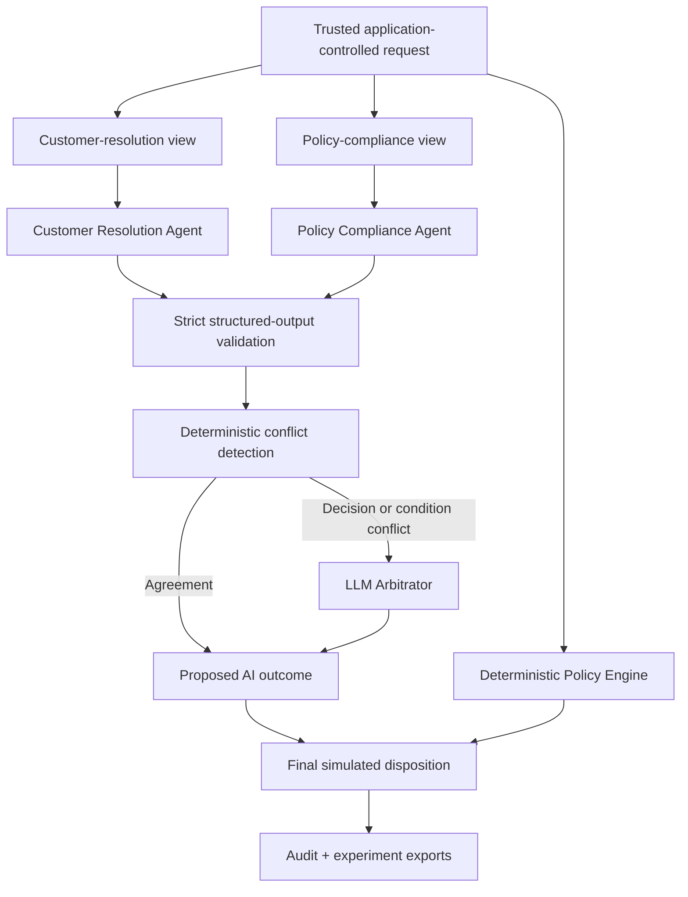

# Agent Disagreement Lab

**A policy-verified Node.js experiment for studying what happens when AI agents disagree.**

Two independent agents review the same refund case from different roles. When their recommendations conflict, an optional third agent arbitrates. A deterministic policy engine then verifies every proposal and remains the final authority.

> [!IMPORTANT]
> This repository is an evaluation and architecture demonstration. It does not issue refunds, connect to payments or customer accounts, or authorize real-world actions.

## The question

Multi-agent systems often introduce another model when two agents disagree. But does a third model actually improve the decision—or merely add latency, cost, and another opportunity for error?

This project makes that question measurable by keeping four stages separate:

1. independent agent recommendations;
2. conflict detection and diagnostic differences;
3. an arbitrator recommendation, invoked only for material conflicts; and
4. deterministic policy verification and the final simulated disposition.

The separation matters: model consensus is not treated as proof of correctness, and arbitration never overrides the policy engine.

## What the experiment observed

The latest clean five-repeat information-view evaluation produced 60 live model records across 30 paired comparisons. Strategy accuracy was calculated over the same 21 valid decision-label disagreements.

| Strategy | Correct | Policy accuracy |
| --- | ---: | ---: |
| Policy-compliance agent | 21/21 | 100% |
| LLM arbitrator | 20/21 | 95.2% |
| Customer-resolution agent | 0/21 | 0% |
| Always escalate | 0/21 | 0% |

Additional observations:

- 19 pairs had a disagreement associated with different information access.
- 1 pair continued to disagree under full information.
- 10 pairs had no decision-label disagreement.
- 2 full-information runs reached an incorrect consensus; deterministic verification corrected both.
- The arbitrator added an average of roughly 6.9 seconds and 1,121 tokens per disagreement.
- No operational failures occurred in the clean retry dataset.

These are exploratory observations from a small, controlled benchmark—not statistically generalizable evidence. In this run, adding an arbitrator did not improve on the policy-compliance baseline.

## Architecture

The implementation is one modular Node.js process with ports-and-adapters boundaries. It is suitable for studying service separation without pretending that a distributed deployment is required.



### Trust boundaries

- The canonical request and policy inputs are application-controlled.
- Role-specific views are immutable projections of the canonical request; facts are omitted, never rewritten.
- Model text cannot upgrade `missing` or `unverified` evidence to `verified`.
- Every model response must satisfy a strict Zod schema.
- Refusals, timeouts, malformed responses, role mismatches, and provider failures are classified separately.
- Retries are bounded and every attempt contributes to usage accounting.
- The deterministic policy verdict remains independent from both consensus and arbitration.

## Quick start

Requirements: Node.js 22 or newer.

```bash
cd agent-disagreement-lab
npm install
npm test
npm run demo
```

The default demo is deterministic mock mode. It requires no API key and clearly labels its output as `mock_demonstration`; mock results are never presented as research findings.

Run one scenario:

```bash
npm run demo -- --scenario S2
```

## Optional OpenAI evaluation

Create a local environment file:

```bash
cp .env.example .env
```

Then add your credentials and a model that supports schema-constrained Responses API output:

```dotenv
OPENAI_API_KEY=your_api_key_here
OPENAI_MODEL=your_supported_model
```

Run a single live scenario:

```bash
npm run demo -- --mode live --scenario S2
```

Run the six-scenario disagreement suite five times:

```bash
npm run demo -- --mode live --suite disagreement --runs 5 \
  --output outputs/disagreement-audit.jsonl \
  --results outputs/disagreement-results.json \
  --report outputs/disagreement-report.json
```

Run the paired information-view suite five times. Six scenarios × five repeats × two arms produces 60 records:

```bash
npm run demo -- --mode live --suite information-view --runs 5 \
  --output outputs/information-view-audit.jsonl \
  --results outputs/information-view-results.json \
  --report outputs/information-view-report.json \
  --handoff-md outputs/article-handoff.md \
  --handoff-json outputs/article-handoff.json
```

Use new output paths for each live experiment. JSONL audit files are append-only.

## Evaluation suites

### Disagreement challenge

Scenarios S9–S14 exercise policy boundaries and ambiguous-but-truthful cases without instructing either agent to be wrong. Results distinguish:

- decision disagreement;
- condition disagreement;
- incorrect consensus; and
- operational failure.

### Information-view evaluation

Scenarios S15–S20 run two paired arms:

- **Asymmetric:** each role receives a different truthful subset of the request.
- **Full information:** both roles receive every canonical request field while retaining their distinct objectives.

An `access_associated` label means a decision disagreement appeared with different information access and disappeared in the full-information control. It is not evidence of faulty reasoning. Arbitration strategies are compared only on observed, valid decision-label disagreements.

## Canonical benchmark policy

The fictional `REFUND_POLICY_V1` defines the ground truth:

- Days 0–30 inclusive: approve when standard return conditions are met, reject when they explicitly fail, and escalate when they are unknown.
- After 30 days: approve only when a qualifying delivery issue and verified evidence are both present.
- A customer report alone does not establish verified evidence.
- Missing or unverified evidence for a plausible late issue requires escalation.
- An explicitly non-qualifying late request is rejected.
- Unknown or conflicting trusted facts require escalation.

The pure policy evaluator runs for every case, including consensus, disagreement, invalid model output, and provider failure paths.

## Repository structure

```text
fixtures/              Controlled scenarios and expected policy verdicts
src/
  agents/              Neutral role prompts
  application/         Single-case and paired experiment orchestration
  cli/                 Commands and human-readable traces
  domain/              Schemas, policy, conflict detection, and analysis
  infrastructure/      Configuration, audits, reports, and exports
  providers/           Deterministic mock and OpenAI adapters
tests/                 Unit, integration, CLI, and acceptance tests
```

## Experiment outputs

Exports preserve the stages needed for independent analysis:

- scenario ID and expected policy verdict;
- both agent recommendations;
- policy-reference and evidence-interpretation differences;
- conflict and evaluation classifications;
- arbitrator recommendation;
- deterministic verification outcome;
- final simulated disposition and override explanation;
- latency, token usage, retries, and sanitized failure diagnostics; and
- information-view arm, pair ID, manifests, and attribution.

Secrets, request headers, raw model output, prompts, and stack traces are not serialized. Generated `outputs/` are ignored by Git so experimental data is not accidentally published.

## Testing

```bash
npm test
```

The test suite covers policy boundaries, trusted-view immutability, strict schemas, conflict diagnostics, false consensus, arbitration overrides, malformed outputs, failures, bounded retry accounting, usage aggregation, paired attribution, strategy comparison, reports, exports, and CLI composition. Provider tests use a fake OpenAI client and do not call the network.

## Limitations

- The refund policy is a simplified benchmark, not legal or operational guidance.
- The scenario set is small and intentionally controlled.
- Live results vary with model, provider state, prompts, and run conditions.
- Five repetitions are useful for exploration but insufficient for strong statistical claims.
- Information-access association is not proof of a reasoning defect.
- A perfect score on this benchmark would not establish production safety.
- JSONL storage is appropriate for this experiment, not concurrent production ingestion.

## Why this repository exists

The useful lesson is not that one agent role always wins. It is that recommendations, arbitration, verification, and authorization are different responsibilities. Systems that collapse them into a single model response cannot reliably measure disagreement—or safely recover when every model agrees on the wrong answer.
